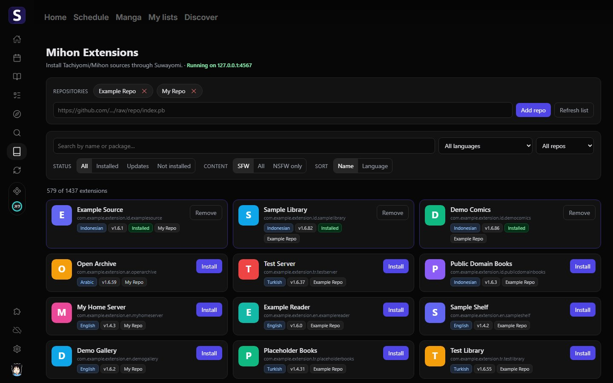
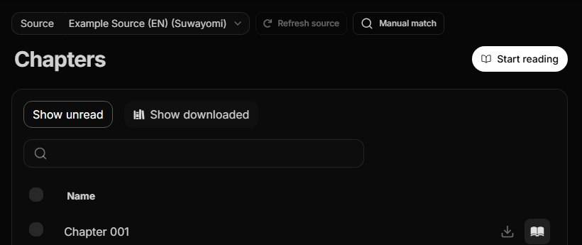
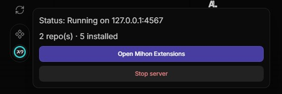

# Seanime × Suwayomi

[English](README.md) · [Bahasa Indonesia](README.id.md) · [Español](README.es.md) · [Português (BR)](README.pt-BR.md) · [简体中文](README.zh-CN.md) · **Русский** · [Français](README.fr.md)

Читайте мангу в [Seanime](https://seanime.app) с **расширениями Tachiyomi / Mihon** через Suwayomi.

Java включена для Windows x64, Linux x64 и macOS. На других устройствах нужна **Java 21+**.



## Быстрый старт

1. Откройте **Extensions → Add extension** в Seanime. Вставьте URL ниже, нажмите **Install**, затем **Grant** при запросе разрешений.

   ```text
   https://raw.githubusercontent.com/oktavianto/seanime-suwayomi/main/dist/suwayomi-launcher.json
   ```

2. Когда Suwayomi будет готов, откройте **Mihon Extensions** в боковой панели. Добавьте URL репозитория (`index.min.json`), установите источник и нажмите **Allow**, чтобы включить его.
3. Откройте мангу → **Source** → выберите `<источник> (Suwayomi)`. Можно читать.

При первом запуске скачивается **200–350 МБ один раз**. Прогресс виден в значке Suwayomi в верхней части Seanime.

> [!IMPORTANT]
> Этот проект не предоставляет, не размещает и не распространяет никакой медиаконтент. Пользователи сами несут ответственность за получение контента законным путём и соблюдение местного законодательства. Расширения, перечисленные в приложении, не связаны ни с этим проектом, ни с Seanime и могут быть удалены, если нарушают авторские права.

---

[Возможности](#features) · [Решение проблем](#решение-проблем) · [Платформы и Java](#поддерживаемые-платформы) · [Разрешения](#разрешения) · [Свой сервер](#свой-сервер-suwayomi) · [Разработка](#разработка)

<a id="features"></a>

## Как это работает

Лаунчер скачивает портативный [Suwayomi-Server](https://github.com/Suwayomi/Suwayomi-Server), запускает его в фоне и автоматически устанавливает провайдер манги.

- **Управление расширениями:** добавляйте репозитории, ищите, фильтруйте, устанавливайте, обновляйте и удаляйте расширения в **Mihon Extensions**.
- **Выбор источника:** каждый установленный источник появляется в Seanime, например `Example (EN) (Suwayomi)`. Смените источник, если не хватает изображений или глав.
- **Поиск по источникам:** выберите **Suwayomi (Mihon/Tachiyomi)**. В **Manual match** видны источник, число глав и последняя глава, например `[Example (EN) · 41 ch · latest 39]`.
- **Изображения и обновления:** изображения идут через прокси Seanime; плагин обновляется через систему обновления расширений Seanime.

| | |
|---|---|
|  |  |
| Главы загружаются из выбранного источника `(Suwayomi)` | Статус сервера в трее |

## Решение проблем

- **Новые источники не появляются в списке Source.** При установке источника Seanime спрашивает *"Allow Suwayomi Launcher to enable …?"*. Нажмите **Allow**. Если вы нажали Don't Allow или вопрос не появился, перезапустите Seanime, и источник загрузится при старте.
- **"Suwayomi did not start".** Возможно, порт 4567 занят другой программой. Закройте её или остановите другой запущенный Suwayomi, затем нажмите **Start / Retry**. В логах Seanime ищите строки, начинающиеся с `[suwayomi]`.
- **Своя папка данных Seanime** (`--datadir`, Docker): Suwayomi работает, но
  провайдеры для отдельных источников создать нельзя. Используйте "Suwayomi (Mihon/Tachiyomi)" и его
  настройку **Sources**.
- **Включён Extension Secure Mode**: Seanime спрашивает разрешение, прежде чем плагин выполнит команду или обратится к файлам. Примите запросы при первом запуске.
- **Источник не работает или стоит за Cloudflare.** Это проблема самого расширения Mihon. Попробуйте другой источник для той же манги.

## Поддерживаемые платформы

| Платформа | Что происходит |
|---|---|
| Windows x64 | Без настройки (Java входит в загрузку) |
| Linux x64 | Без настройки (Java включена) |
| macOS Apple Silicon / Intel | Без настройки (Java включена) |
| Всё остальное (Linux ARM64, Raspberry Pi, …) | Нужна установленная **Java 21+**, см. ниже |

### Java 21 на других устройствах

На этих устройствах плагин использует обычный `Suwayomi-Server.jar` с системной Java. Если Java
нет или она слишком старая, трей и страница Mihon Extensions сообщат об этом и подскажут, что установить:

| Система | Команда |
|---|---|
| Debian / Ubuntu / Raspberry Pi OS | `sudo apt install openjdk-21-jre-headless` |
| Fedora | `sudo dnf install java-21-openjdk-headless` |
| Arch | `sudo pacman -S jre21-openjdk-headless` |
| Alpine | `sudo apk add openjdk21-jre-headless` |
| Любая ОС | [Temurin 21 JRE](https://adoptium.net/temurin/releases/?version=21) |

Проверьте командой `java -version` (должно быть 21 или выше), затем нажмите **Start / Retry**.
Если Seanime уже работал, когда вы устанавливали Java, перезапустите его, чтобы он увидел новый `PATH`.

## Разрешения

Лаунчер — это плагин Seanime с областями `system` и `extensions`. Что ему разрешено:

| Разрешение | Зачем |
|---|---|
| Чтение/запись `<config>/Seanime/suwayomi/**` | Загрузка Suwayomi, его данные и установленные расширения |
| Запись `<config>/Seanime/extensions/suwayomi.json` и `suwayomi-src-*.json` | Генерируемые им провайдеры манги (по одному на источник). Другие файлы расширений не затрагиваются |
| Включение/отключение расширений `suwayomi` и `suwayomi-src-*` | Сразу загрузить провайдер нового источника. Seanime сначала спрашивает: *"Allow Suwayomi Launcher to enable …?"* |
| Запуск `jre/bin/java[.exe] … -jar bin/Suwayomi-Server.jar` | Запуск Suwayomi только на `127.0.0.1:4567` |
| Запуск `java -version`, `tar -xzf` | Проверка Java (другие платформы) и распаковка загрузки (Linux/macOS) |
| Сеть: `127.0.0.1`, GitHub | Локальный сервер Suwayomi и релизы Suwayomi на GitHub |

`<config>` — это `%APPDATA%` в Windows, `~/Library/Application Support` в macOS и `~/.config` в Linux.
Это папка данных Seanime по умолчанию.

## Свой сервер Suwayomi

Если у вас уже запущен Suwayomi (например, в Docker), можно установить только провайдер:

```
https://raw.githubusercontent.com/oktavianto/seanime-suwayomi/main/dist/suwayomi.json
```

Затем укажите его **Suwayomi server URL** и при необходимости логин и пароль. Также можно
добавить `https://raw.githubusercontent.com/oktavianto/seanime-suwayomi/main/dist/repo.json` как репозиторий.

## Удаление

Удалите "Suwayomi Launcher", "Suwayomi (Mihon/Tachiyomi)" и провайдеры `… (Suwayomi)` в
**Extensions**. Затем удалите папку `<config>/Seanime/suwayomi` — в ней загрузка, данные Suwayomi и его расширения.

## Разработка

См. раздел [Development в английском README](README.md#development).

## Благодарности и отказ от ответственности

Основано на [Suwayomi-Server](https://github.com/Suwayomi/Suwayomi-Server) (MPL-2.0), который запускает
расширения [Mihon](https://mihon.app)/Tachiyomi, и на [Seanime](https://github.com/5rahim/seanime).
Проект не размещает никакого контента и не поставляет расширения. Источники берутся из репозиториев, которые вы добавляете сами.

[Лицензия MIT](LICENSE)
